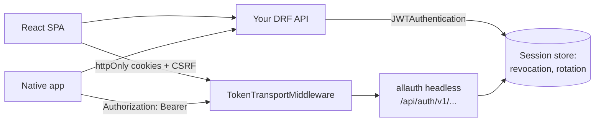

# dj-rest-jwt

Secure, API-first JWT authentication for Django, built on
[django-allauth](https://docs.allauth.org/) headless.

allauth does the authentication itself: login, signup, email verification, password reset, TOTP
and recovery codes, passkeys, 100+ social providers, device sessions, and JWT minting with
refresh-token rotation. dj-rest-jwt adds the layer an API-first project still needs, with every
protection switched on:

- **Cookies for browsers, headers for apps.** A React SPA gets httpOnly cookies that script can
  never read. A native app sends `X-Auth-Transport: header` and uses `Authorization: Bearer`.
  [More](guides/transports.md)
- **Stays signed in.** Each refresh issues a new refresh token, so a user who comes back within
  30 days never logs in again, like Google or Instagram. [More](guides/sessions.md)
- **Theft detection and instant revocation.** Replaying an old refresh token ends the session;
  logging out or revoking a device takes effect on the next request.
- **A JavaScript client** that refreshes on 401, shares one refresh across tabs, and wraps every
  flow including passkeys. [More](guides/js-client.md)
- **Codes or links in emails**, one setting; every email editable. [More](guides/emails.md)
- **A secure admin, signup anti-spam, a secure settings preset, and system checks** that flag
  anything that weakens it.

## How it fits together

Each JWT login is backed by a server-side session, which is what makes revocation instant and
refresh-token reuse detectable. Sessions are never a client credential; the client only ever
holds JWTs (or cookies containing them).

## Requirements

Python 3.12+, Django 6.0+, django-allauth 65.22+.

[Get started](quickstart.md){ .md-button .md-button--primary }
[Try the demo](https://github.com/memetrusidovski/dj-rest-jwt/tree/main/demo){ .md-button }
